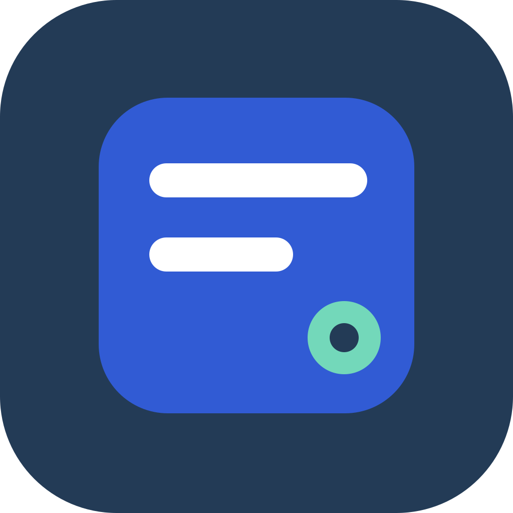
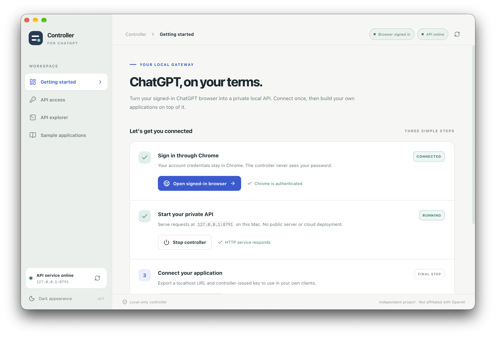
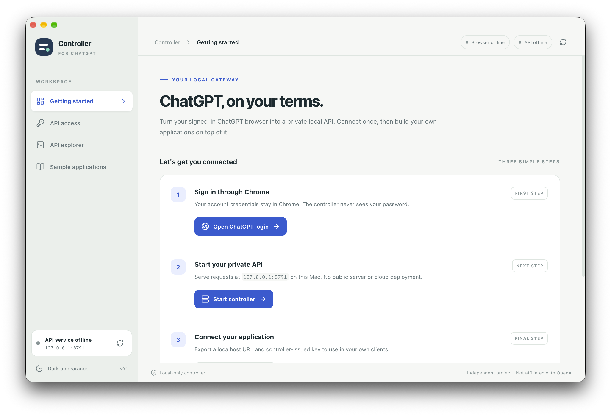
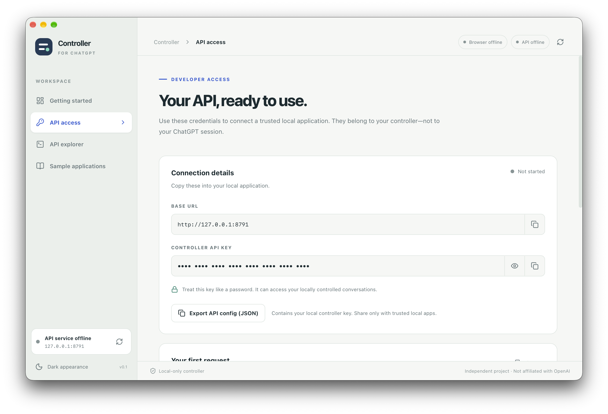
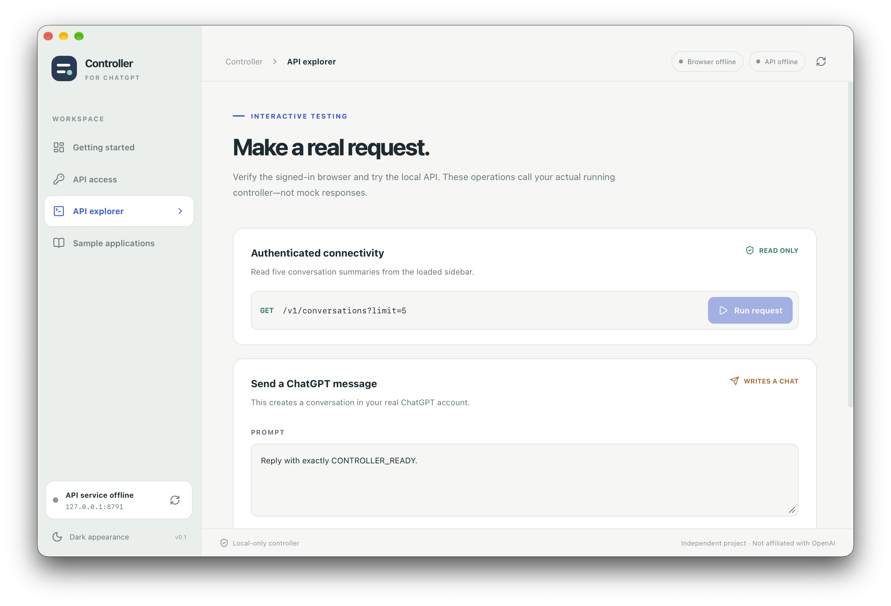
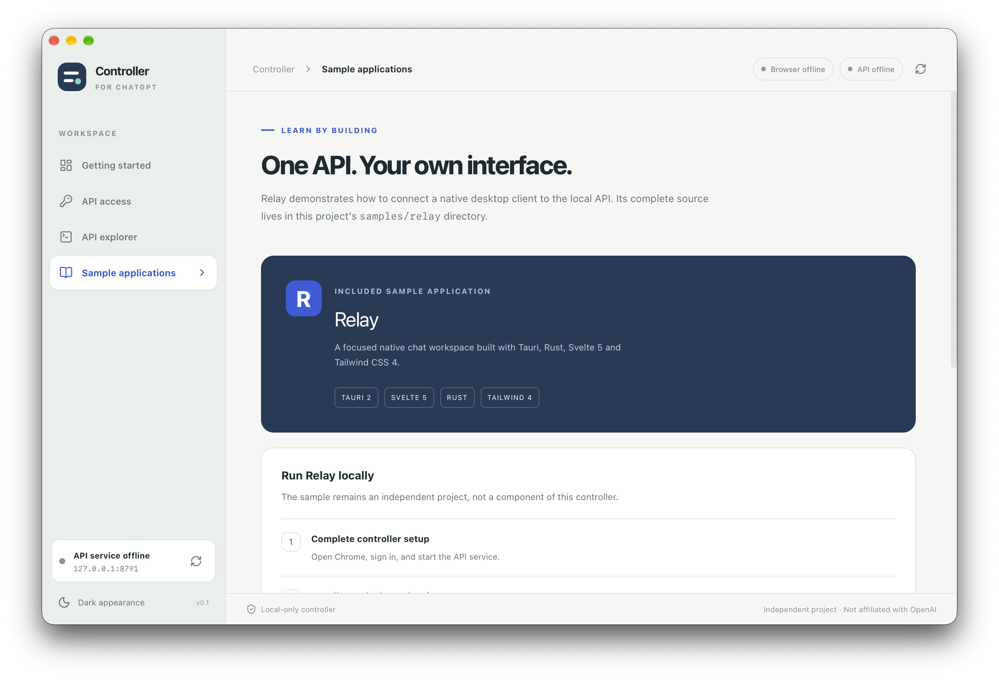
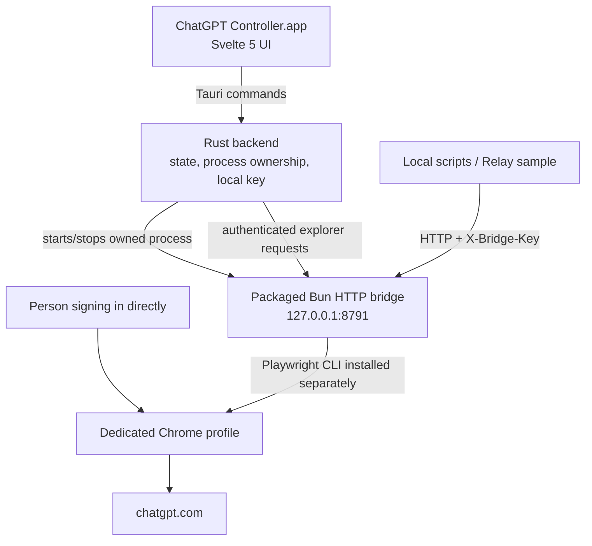

<div align="center">



# ChatGPT Controller

**Your signed-in ChatGPT browser. Your own local API.**

A native macOS control center that exposes a private, authenticated HTTP interface to a ChatGPT session you open and sign in to yourself.

[](https://github.com/AungMyoKyaw/chatgpt-controller-desktop)
[](#requirements)
[](https://tauri.app/)
[](https://svelte.dev/)
[](https://www.rust-lang.org/)
[](LICENSE)

**[Quick start](#quick-start)** · **[Features](#features)** · **[API](#localhost-api)** · **[Architecture](#architecture)** · **[Development](#development)** · **[Limitations](#limitations)**

</div>

> [!IMPORTANT]
> **Independent, unofficial project.** This is browser automation of a user-controlled ChatGPT session, **not** the official OpenAI API, an OpenAI product, or a way around ChatGPT subscription limits. The user signs in directly in a dedicated visible Chrome window. The application does not export ChatGPT cookies, passwords, or bearer tokens.



## Why it exists

ChatGPT Controller lets developers, AI engineers, and automation builders experiment with their **own signed-in ChatGPT browser** from local software—without embedding a login form, collecting browser session tokens, or making an external web service the middleman.

The macOS app manages a locally packaged HTTP controller. A separately installed Playwright CLI drives a dedicated Chrome profile, while a controller-generated secret authenticates local clients. You can connect a script, CLI, or another native app, such as the included [Relay sample](samples/relay/).

**The important distinction:** clients talk to a browser-backed localhost bridge; they do **not** receive an official OpenAI API credential or direct access to the underlying ChatGPT network session.

## Features

| Capability              | What is implemented                                                                                   |
| ----------------------- | ----------------------------------------------------------------------------------------------------- |
| Guided setup            | Open a dedicated Chrome profile, sign in yourself, start the controller, and inspect connection state |
| Native desktop utility  | Tauri 2 + Rust + Svelte 5 interface, light-first with dark-mode support                               |
| Private local API       | HTTP on `127.0.0.1:8791` with a separate local `X-Bridge-Key`                                         |
| Conversation access     | Create/continue chats in the browser; read messages via authenticated background requests             |
| Conversation management | Account-wide paginated listing; background rename, archive, delete and message reads; explicit open   |
| API access page         | Copy endpoint, reveal/copy local key, or copy connection config as JSON                               |
| API explorer            | Probe the authenticated conversation endpoint and explicitly submit a test prompt                     |
| External client example | Relay, a separate Tauri/Svelte/Rust desktop chat client                                               |
| Process ownership       | Stop only a controller process launched by this app; do not terminate an externally managed service   |
| Built-in checks         | Report browser dependency, browser sign-in, and controller availability                               |

The bridge serializes UI-changing browser operations. Read-only account discovery and bulk status monitoring use authenticated background requests, without opening or switching tabs. Account discovery is paginated and can fall back to loaded sidebar entries when upstream listing is unavailable. Chat send and explicit open remain browser UI operations, but skip reloading a matching open conversation; response detection uses the visible generation-stop state instead of a fixed four-second delay. ChatGPT model generation latency remains outside the controller’s control.

## Quick start

### Requirements

- **macOS on Apple Silicon (ARM64)** — the currently documented build target.
- **Google Chrome**, installed locally.
- **Playwright CLI** available as `playwright-cli`. It is **not bundled** with v0.1.0.
- A ChatGPT account you can sign in to via the dedicated Chrome window.
- Port `127.0.0.1:8791` available for the local controller.

For a **source build**, also install [Bun](https://bun.sh/), the [Rust toolchain](https://rustup.rs/), and Apple developer command-line tools (run `xcode-select --install` if needed).

Install Playwright CLI:

```bash
bun add -g @playwright/cli
playwright-cli --help
```

The app looks for Playwright CLI on `PATH` and in several common Bun, mise, and Homebrew locations. It uses the locally installed Chrome browser.

### 1. Get the application

**Install the public v0.1.0 release with Homebrew:**

```bash
brew install --cask aungmyokyaw/tap/chatgpt-controller
```

**Direct download:** visit [GitHub Releases](https://github.com/AungMyoKyaw/chatgpt-controller-desktop/releases/tag/v0.1.0), download `ChatGPT-Controller-v0.1.0-macos-arm64.zip`, verify the digest in `SHA256SUMS`, extract the archive, and move `ChatGPT Controller.app` into Applications.

> Distribution builds are **ad-hoc signed**, but **not Apple Developer ID signed or notarized**. macOS may require approval in **System Settings → Privacy & Security** before first launch. Chrome and Playwright CLI are separate prerequisites for v0.1.0.

**Build and launch from source** (with repository access):

```bash
git clone git@github.com:AungMyoKyaw/chatgpt-controller-desktop.git
cd chatgpt-controller-desktop
make install
make dev
```

`make dev` builds the Bun sidecar and runs the native Tauri development application. For a distributable local `.app` bundle instead:

```bash
bun run check
cargo test --manifest-path src-tauri/Cargo.toml
make build
open "src-tauri/target/release/bundle/macos/ChatGPT Controller.app"
```

`make build` packages the sidecar into the macOS app. It does **not** bundle Chrome or Playwright CLI.

### 2. Connect your browser

1. Open **ChatGPT Controller → Getting started**.
2. Select **Open ChatGPT login**. The application launches a dedicated, visible Chrome profile.
3. **Sign in directly in Chrome.** Do not enter your ChatGPT credentials into the controller.
4. Select **Start controller** and refresh the status indicators.
5. Open **API access** to copy the localhost URL and controller key.
6. Open **API explorer** to list available conversations or deliberately send a test message.

The app uses an isolated Playwright session called `chatgpt-controller`. Your normal Chrome profile is not required.

### 3. Make your first API call

After the browser is signed in and the controller is running:

```bash
curl --fail-with-body \
  'http://127.0.0.1:8791/v1/conversations?limit=5' \
  -H "X-Bridge-Key: $(cat ~/.config/chatgpt-browser-controller/bridge.key)"
```

Create a new conversation (this **submits a real prompt** to your signed-in ChatGPT session):

```bash
curl --fail-with-body \
  http://127.0.0.1:8791/v1/chat \
  -H "X-Bridge-Key: $(cat ~/.config/chatgpt-browser-controller/bridge.key)" \
  -H "Content-Type: application/json" \
  --data '{"prompt":"Explain Kubernetes networking in three steps."}'
```

A successful response includes a `reply` and a `conversation_path`. To continue that conversation, supply the exact returned path:

```json
{
  "prompt": "Continue with an example.",
  "conversation_path": "/c/<uuid>"
}
```

Do not post the key or the exported API config in issues, screenshots, logs, or public repositories.

## Screenshots

Real application screens from the macOS build. Browser and controller status reflect the environment at capture time; they are not a simulated success guarantee.

|                               Getting started                                |                                     API access                                      |
| :--------------------------------------------------------------------------: | :---------------------------------------------------------------------------------: |
|  |            |
|                               **API explorer**                               |                                  **Relay sample**                                   |
|                            |  |

## Localhost API

**Base URL:** `http://127.0.0.1:8791`

**Authentication:** `X-Bridge-Key: <local-controller-key>` on every route except `GET /health`

**Content type:** `application/json` for JSON request bodies

| Method   | Endpoint                                       | Purpose                                                        |
| -------- | ---------------------------------------------- | -------------------------------------------------------------- |
| `GET`    | `/health`                                      | Check whether the HTTP bridge is running; unauthenticated      |
| `GET`    | `/v1/conversations?limit=25`                   | Background account listing (limit `1`–`100`); sidebar fallback |
| `GET`    | `/v1/conversations/{uuid}/messages`            | Read conversation messages in background                       |
| `GET`    | `/v1/conversations/{uuid}/status`              | Check individual generation status                             |
| `GET`    | `/v1/conversations/statuses?limit=20&offset=0` | Monitor paginated account conversations                        |
| `POST`   | `/v1/conversations/statuses`                   | Monitor 1–50 explicit conversation IDs                         |
| `POST`   | `/v1/conversations/{uuid}/open`                | Open a known conversation                                      |
| `POST`   | `/v1/chat`                                     | Create a conversation or reply using `conversation_path`       |
| `POST`   | `/v1/chat/completions`                         | Limited non-streaming JSON compatibility                       |
| `PATCH`  | `/v1/conversations/{uuid}`                     | Rename via `{"title":"New title"}`                             |
| `POST`   | `/v1/conversations/{uuid}/archive`             | Archive with a JSON body (`{}`)                                |
| `DELETE` | `/v1/conversations/{uuid}`                     | Delete only with `{"confirm":true}`                            |

The compatibility endpoint is **not** a drop-in replacement for OpenAI's API: `stream:true` is unsupported, arbitrary model IDs are unsupported, and the browser controller has different response semantics and limits. If specifying a model, `chatgpt-web` is the only accepted value.

For expected error codes, timeouts, behavior, and the typed client implementation, see [docs/API.md](docs/API.md) and [controller/controller-client.ts](controller/controller-client.ts).

## Architecture



- **Svelte 5 + Tailwind CSS 4:** setup, connection status, API access, explorer, and sample app walkthrough.
- **Rust + Tauri 2:** native commands, local secret creation, status checks, process management, and the packaged sidecar.
- **Bun + TypeScript:** localhost HTTP route validation, request handling, and browser orchestration.
- **Playwright CLI + Chrome:** interactions with the visible signed-in ChatGPT webpage. Playwright CLI is a **separate installation**, not embedded in the release.
- **Relay:** an independent example client consuming the same localhost bridge.

### Local files and boundaries

| Location                                              | Purpose                                              |
| ----------------------------------------------------- | ---------------------------------------------------- |
| `~/.config/chatgpt-browser-controller/bridge.key`     | Locally generated bridge key, file permission `0600` |
| `~/.config/chatgpt-browser-controller/controller.log` | Local controller process log                         |
| `~/.playwright-cli/chatgpt-controller-profile`        | Dedicated persistent Chrome profile                  |
| `127.0.0.1:8791`                                      | Loopback-only HTTP listener                          |

**Sign-in stays in Chrome.** The bridge does not export or replay ChatGPT cookies, bearer tokens, or the user's password. The separate controller key gives local clients access to sensitive chat operations, so treat the key as a secret, protect your macOS account, and do not expose the port through tunneling or reverse proxies. The **Export API config (JSON)** action copies a configuration containing the local key to the clipboard.

If the port is already serving an API, the GUI can detect that server without claiming to own it. **Stop controller** only terminates a process started by the current app instance.

## Relay example

[`samples/relay/`](samples/relay/) contains a separate macOS application demonstrating a native client for this API. Its Rust backend reads the same local key file and calls the loopback service without exposing the bridge key to its Svelte frontend.

To run Relay after starting the controller:

```bash
cd samples/relay
bun install
bun run tauri dev
```

See [Relay integration notes](samples/relay/CONTROLLER-INTEGRATION.md). Relay is **not** required to run ChatGPT Controller.

## Development

### Project structure

```text
chatgpt-controller-desktop/
├── controller/              # Bun HTTP server, browser and conversation automation, client, tests
├── src/                     # Svelte UI and frontend utilities
├── src-tauri/               # Rust commands, Tauri configuration, native application
├── docs/
│   ├── API.md               # Detailed HTTP API reference
│   └── screenshots/         # Real application screenshots
├── samples/relay/           # Independent native API client
├── PRODUCT.md               # Product scope and behavior
├── DESIGN.md                # Design system / Impeccable direction
├── Makefile
└── README.md
```

### Commands

```bash
make install                                    # Install dependencies from bun.lock
make dev                                        # Build sidecar and run the Tauri dev app
bun test controller                             # Bun controller and typed client tests
bun run check                                   # Svelte + TypeScript checks
cargo test --manifest-path src-tauri/Cargo.toml # Rust tests
bun run build                                   # Frontend build only
make build                                      # Build native macOS .app with bundled sidecar
make format                                     # Format Svelte/TypeScript and Rust sources
```

The Tauri application is configured with a local Vite development server. The native build produces `src-tauri/target/release/bundle/macos/ChatGPT Controller.app`.

For the rationale behind the light-first **Quiet Control Room** design, see [DESIGN.md](DESIGN.md). For product goals, see [PRODUCT.md](PRODUCT.md).

### GitHub Actions CI/CD and releases

- [Controller CI](.github/workflows/ci.yml) checks source, tests, and Rust on every pull request and push to `master`.
- [macOS ARM64 Release](.github/workflows/release.yml) builds an ad-hoc signed `.app` ZIP with SHA-256 checksums. Manual workflow dispatch builds an artifact without publishing; an annotated `vX.Y.Z` tag publishes a release once the repository is public.
- The public Homebrew tap checks for releases on a schedule and automatically pins published checksums. An optional, scoped `HOMEBREW_TAP_TOKEN` enables immediate tap updates after publication.
- See [Release engineering guide](docs/RELEASING.md) for setup, tagging, verification, and rollback.

## Troubleshooting

| Symptom                                   | What to check                                                                                                           |
| ----------------------------------------- | ----------------------------------------------------------------------------------------------------------------------- |
| **Playwright CLI missing**                | Install `@playwright/cli` and ensure `playwright-cli --help` works in your shell; restart the desktop app afterward     |
| **Dedicated browser does not open**       | Verify Chrome is installed and that Playwright CLI can start Chrome with a headed persistent profile                    |
| **Not authenticated / HTTP 401**          | Sign in to ChatGPT in the **dedicated** Chrome profile; check that the request includes the correct controller key      |
| **Controller offline**                    | Start it in Getting started; check whether port `8791` is already in use and review the local controller log            |
| **HTTP 429**                              | Another browser operation is executing; allow it to finish before retrying                                              |
| **Conversation not found or unavailable** | The identifier must be a valid conversation UUID and the thread must be accessible in the signed-in browser             |
| **HTTP 422**                              | Remove unsupported `stream:true` or model selection; use non-streaming requests and `chatgpt-web` if providing a model  |
| **HTTP 502/503/504 or timeout**           | Inspect the Chrome window; the page may have changed or a submitted message may still finish after the bridge times out |
| **Downloaded app will not open**          | The release is not signed/notarized; use macOS's trusted-app opening workflow or build locally from source              |

## Limitations

- **Not an official API or model gateway.** Site changes may break browser selectors and therefore bridge functionality.
- **No limit bypass.** ChatGPT usage limits, availability, browser access and applicable account restrictions still apply.
- **One UI-changing browser action at a time.** During an in-flight chat, polling known IDs reports its local in-progress state without triggering additional navigation.
- **No true token streaming.** The compatibility route returns a completed response, not token-by-token events.
- **Conversation discovery limitations.** Account-index paging can omit archived or otherwise unlisted chats; the sidebar fallback declares reduced coverage.
- **Browser-dependent reliability.** A response timeout does **not** guarantee that ChatGPT did not already receive the prompt. Inspect Chrome before sending a duplicate.
- **Platform and distribution scope.** Only macOS Apple Silicon is documented; Chrome and Playwright CLI remain external prerequisites; the current app bundle is unsigned.
- **Local access is still sensitive.** Anyone able to read the key and reach the local port may perform available chat operations, including destructive ones.

## Roadmap (ideas, not commitments)

Possible improvements include signed/notarized macOS releases, publishing release assets and install automation, stronger end-to-end browser regression tests, and broader supported client workflows. These are **proposals**, not promised release dates or claims that the features exist today.

## Contributing and support

The project is presently in an early v0.1.0 stage. When repository access permits, bug reports and scoped pull requests are welcome via [GitHub Issues](https://github.com/AungMyoKyaw/chatgpt-controller-desktop/issues). Include a reproducible description, platform details, and relevant **redacted** logs; never attach browser profiles, the bridge key, or personal conversations.

Before submitting a code change, run the applicable checks in [Development](#development). Use GitHub Issues for discussion unless GitHub Discussions is enabled.

Created by **[Aung Myo Kyaw](https://github.com/AungMyoKyaw)**.

## License

Copyright © Aung Myo Kyaw and contributors.

Licensed under the **GNU Affero General Public License, version 3.0 or later (AGPL-3.0-or-later)**. See [LICENSE](LICENSE). The included Relay sample uses the same license.

---

<div align="center">

**Local-first. Browser-backed. Built for developers.**

</div>
